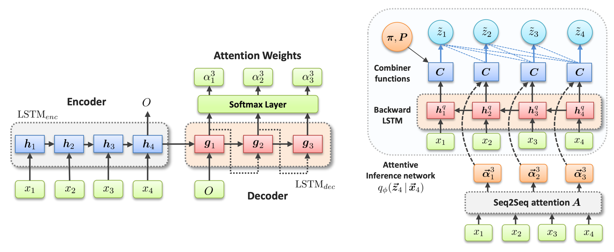

# Attentive State-space Modeling of Disease Progression

This is a [pyro](https://pyro.ai/) implementation of [*Attentive State-Space Modeling of Disease Progression*](https://proceedings.neurips.cc/paper_files/paper/2019/file/1d0932d7f57ce74d9d9931a2c6db8a06-Paper.pdf) by Alaa and van der Schaar in NeurIPS 2019. This codebase implements the non-Markovian/attention-based state transitions, LSTM encoder/decoder attention, mixed Gaussian/conditional-Bernoulli emissions, and structured variational inference using built-in functions in [pyro](https://pyro.ai/). The notebook "Attentive SS Models.ipynb" contains a demo of how to use the model training and inference APIs on a toy synthetic data generation process.



## Installation

You can install all requirements for this codebase through:

```bash
python -m pip install -r requirements.txt
python -m pytest -q
```

To import the package from outside this directory, you can install it with
`python -m pip install -e .`. Note that Python 3.10+ is required. 

## Folder contents

| File | Description |
|---|---|
| `Attentive SS Models.ipynb` | Demo in synthetic data with training, evaluation and API examples |
| `assm/config.py` | Model and training configuration dataclasses |
| `assm/networks.py` | Seq2seq attention, backward LSTM and linear combiner implementations |
| `assm/emissions.py` | Full/diagonal Gaussian and conditional Bernoulli emissions |
| `assm/model.py` | Pyro generative model and structured inference network |
| `assm/training.py` | Warm starting and implementation of the score function SVI |
| `assm/inference.py` | Smoothing, filtering, and forecasting functions |
| `assm/estimator.py` | Different functions for the model class, e.g. `fit`, `posterior`, `filter`, `forecast`, `save`, `load` API |
| `assm/synthetic.py` | Data generation model for the synthetic data experiment in the demo |
| `assm/data.py` | Utils for dealing with patient batches, padding, prefixes and device transfer |
| `assm/evaluation.py` | Eval metrics |
| `docs/METHOD.md` | Model description |
| `docs/API.md` | Training/inference interface and required tensor shapes|
| `tests/test_probabilistic_contract.py` | Checks for known errors |
| `results/` | Our eval metrics, training logs and inference checkpoint |
| `figures/` | Exported plots from tge demo |

## Minimal API

You can find more detailed description of the API in this [link](https://github.com/ahmedmalaa/attentive-state-space-models/edit/master/docs/API.md).

```python
from assm import AttentiveSSM, ModelConfig, TrainingConfig, generate_synthetic

# load synthetic data
data = generate_synthetic()["batch"]
train, test = data.select(list(range(320))), data.select(list(range(384, 480)))

# instantiate and train an attentive state space model
model = AttentiveSSM(ModelConfig(num_states=3), seed=19)
model.fit(train, training=TrainingConfig(epochs=60))

# latent state inference
posterior = model.posterior(test, num_samples=128)
state_probabilities = posterior["probs"]  # [patients, visits, states]

# prediction and forecasting of future states and observations
prediction = model.forecast(test.prefix(8), horizon=3, num_samples=128)
model.save("my_model.pt")
restored = AttentiveSSM.load("my_model.pt")
```
## Reproducing our experiments

The experiments were conducted using data from the UK Cystic Fibrosis Trust registry. You can apply for access to this dataset through this [website](https://www.cysticfibrosis.org.uk/about-us/uk-cf-registry/apply-for-data-from-the-uk-cf-registry).

You can reproduce all experiments in our paper through our legacy tensorflow codebase under the [tf-codebase](https://github.com/ahmedmalaa/attentive-state-space-models/tree/master/tf-codebase) directory, which also includes all implementations for the baseline models. The We provide comprehensive details on how to process the data and run experiments using the tf implementation in this [notebook](https://github.com/ahmedmalaa/attentive-state-space-models/blob/master/tf-codebase/Cystic_Fibrosis_Experiments.ipynb). 

You can reproduce the predictive performance of our legacy implementation using the Pyro implementation within the error bars using $K=8$ states: 


| Model | Diabetes | ABPA | Depression | Pancreatitis | P. aeruginosa |
|---|---|---|---|---|---|
| **Pyro ASSM** | 0.705 ± 0.03 | 0.762 ± 0.03 | 0.744 ± 0.05 | 0.681 ± 0.04 | 0.671 ± 0.02 |


## Notes

- There is a typo in the published paper on page 2: *"To demonstrate the practical significance of the attentive state-space model, we use it to model
the progression trajectories of **breast cancer**** using data from the UK Cystic Fibrosis registry."* This statement was referring to **cystic fibrosis** and not **breast cancer**.

- In the data_loader() function, we dropped the ID index in line 59 (X_obs.append(data[k][:, 1:])). This inadvertently led to the column names in the tensorflow [notebook](https://github.com/ahmedmalaa/attentive-state-space-models/blob/master/tf-codebase/Cystic_Fibrosis_Experiments.ipynb) to be shifted by 1, which propagated to the headers of Table 2 in the paper. The correct outcome names should be: Diabetes -> Arthropathy, ABPA -> Hypertension, Depression -> Hemoptysis, Pancreatitis -> Hearing Loss, P. aeruginosa -> Haemophilus Influenza.  

## References

- Alaa, A. M., & van der Schaar, M. (2019).
  [Attentive State-Space Modeling of Disease Progression](https://proceedings.neurips.cc/paper_files/paper/2019/hash/1d0932d7f57ce74d9d9931a2c6db8a06-Abstract.html).
- Pyro: [SVI and TraceGraph_ELBO](https://docs.pyro.ai/en/stable/inference_algos.html).
- Pyro: [ELBO gradient estimators](https://pyro.ai/examples/svi_part_iii.html).
